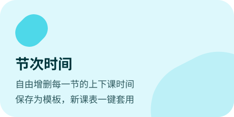
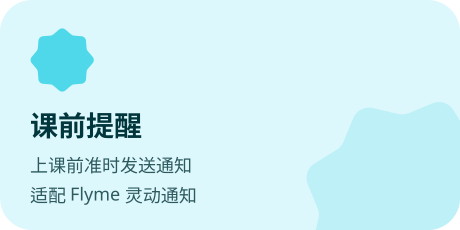
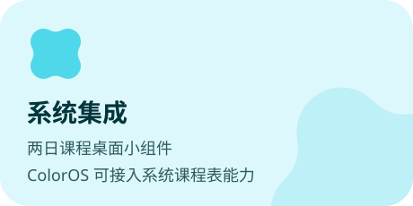
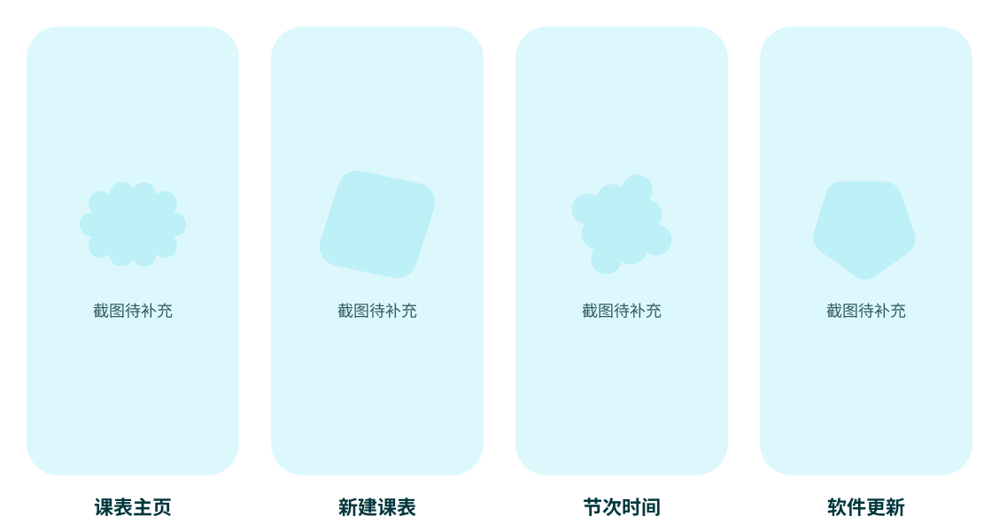

<picture>
  <source media="(prefers-color-scheme: dark)" srcset="./background.svg">
  
</picture>

<h3 align="center">一个美观的 Material 3 Expressive 风格课表</h3>

<p align="center">
  
  
  
  
  
</p>

> [!NOTE]
> Star Schedule 仍处于测试阶段，界面和功能会持续调整，欢迎通过 Issue 反馈问题与建议。

<br>

<picture>
  <source media="(prefers-color-scheme: dark)" srcset="./docs/readme/title-features-dark.svg">
  
</picture>

<p align="center">
  <picture>
    <source media="(prefers-color-scheme: dark)" srcset="./docs/readme/feature-timetable-dark.svg">
    
  </picture>
  <picture>
    <source media="(prefers-color-scheme: dark)" srcset="./docs/readme/feature-import-dark.svg">
    
  </picture>
  <picture>
    <source media="(prefers-color-scheme: dark)" srcset="./docs/readme/feature-ai-dark.svg">
    
  </picture>
  <picture>
    <source media="(prefers-color-scheme: dark)" srcset="./docs/readme/feature-lesson-dark.svg">
    
  </picture>
  <picture>
    <source media="(prefers-color-scheme: dark)" srcset="./docs/readme/feature-reminder-dark.svg">
    
  </picture>
  <picture>
    <source media="(prefers-color-scheme: dark)" srcset="./docs/readme/feature-system-dark.svg">
    
  </picture>
  <picture>
    <source media="(prefers-color-scheme: dark)" srcset="./docs/readme/feature-wallpaper-dark.svg">
    
  </picture>
  <picture>
    <source media="(prefers-color-scheme: dark)" srcset="./docs/readme/feature-update-dark.svg">
    
  </picture>
</p>

<br>

<picture>
  <source media="(prefers-color-scheme: dark)" srcset="./docs/readme/title-screenshots-dark.svg">
  
</picture>

<p align="center">
  <picture>
    <source media="(prefers-color-scheme: dark)" srcset="./docs/readme/screenshots-dark.svg">
    
  </picture>
</p>

<br>

<picture>
  <source media="(prefers-color-scheme: dark)" srcset="./docs/readme/title-download-dark.svg">
  
</picture>

<p>
  <a href="https://github.com/lightStarrr/starSchedule/releases/latest"><picture><source media="(prefers-color-scheme: dark)" srcset="./docs/readme/button-release-dark.svg"></picture></a>
  &nbsp;
  <a href="https://github.com/lightStarrr/starSchedule/releases/tag/snapshot"><picture><source media="(prefers-color-scheme: dark)" srcset="./docs/readme/button-snapshot-dark.svg"></picture></a>
</p>

- **系统要求**：Android 13（API 33）及以上。
- **正式版**：推送 `v*` 标签后自动构建，附带签名 APK、校验和与更新日志。
- **快照版**：跟随主分支最新提交自动构建，可以抢先体验新功能，但可能不稳定。
- 安装后可在「设置 → 软件更新」中检查更新，打开「也检测快照更新」即可接收快照版。
- ColorOS 用户如需接入系统课程表能力，需要额外安装 `wakeup-proxy` 代理应用。

<br>

<picture>
  <source media="(prefers-color-scheme: dark)" srcset="./docs/readme/title-build-dark.svg">
  
</picture>

项目使用 Kotlin + Jetpack Compose（Material 3 Expressive）开发，数据层基于 Room。构建需要 JDK 17 及以上（CI 使用 JDK 21），推荐直接使用 Android Studio 自带的 JBR。

```powershell
git clone https://github.com/lightStarrr/starSchedule.git
cd starSchedule

.\gradlew :app:assembleDebug        # 构建调试包
.\gradlew :app:testDebugUnitTest    # 运行单元测试
```

| 模块 | 说明 |
| --- | --- |
| `app` | 主应用 |
| `wakeup-proxy` | ColorOS 系统课程表能力的代理应用 |

欢迎提交 Issue 和 Pull Request。开始之前请先阅读：

- [`AGENTS.md`](./AGENTS.md)：项目架构、代码风格与提交规范
- [`docs/ci.md`](./docs/ci.md)：自动构建与发布流程

<br>

<picture>
  <source media="(prefers-color-scheme: dark)" srcset="./docs/readme/title-license-dark.svg">
  
</picture>

本项目基于 [Apache License 2.0](./LICENSE) 开源。
